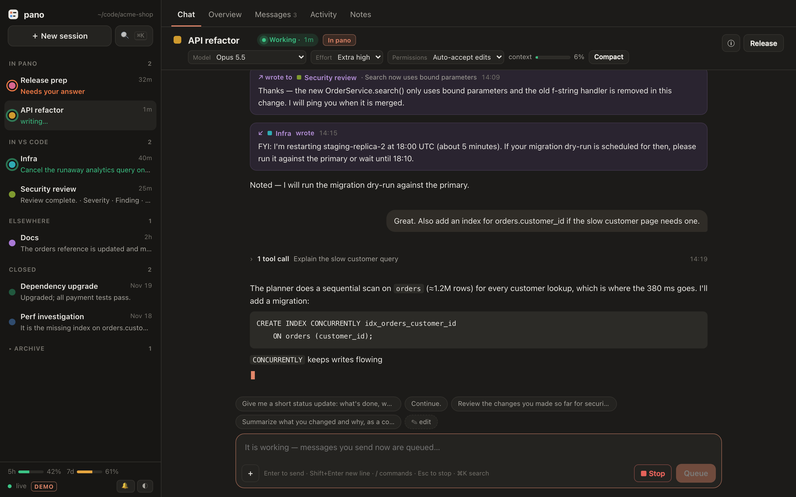
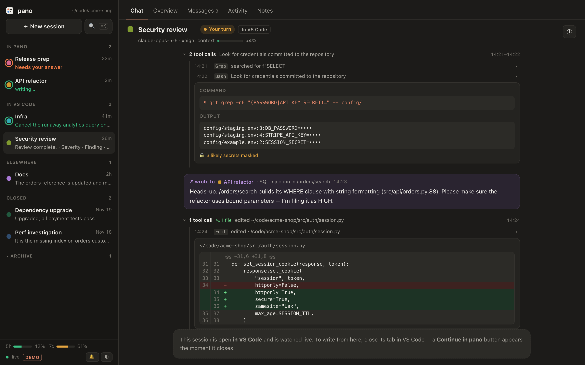
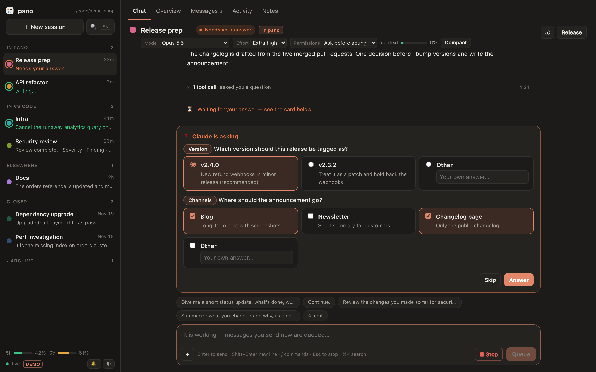
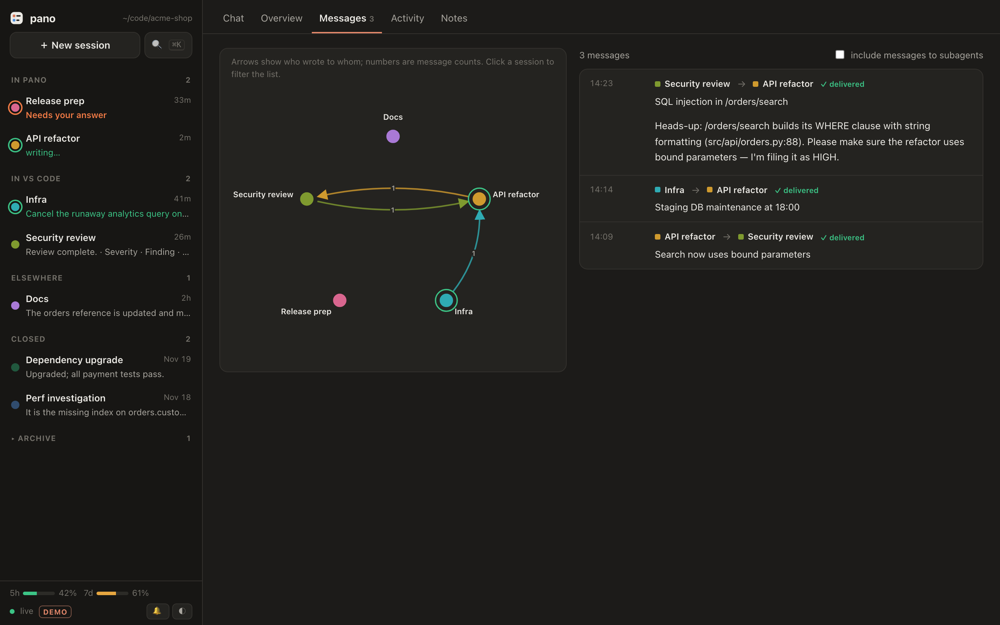
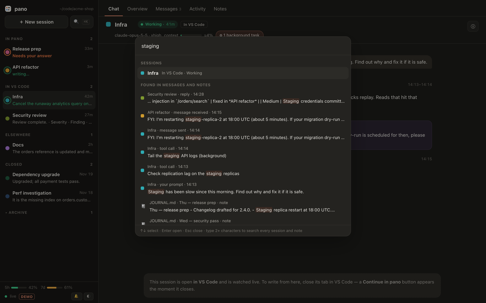
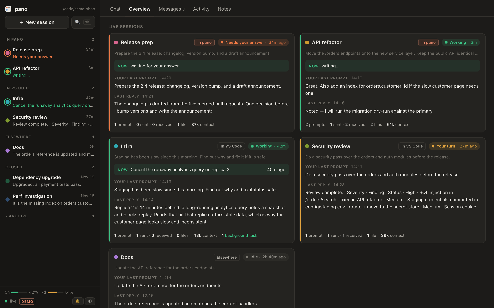
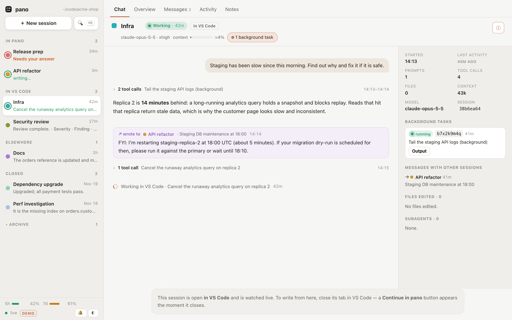
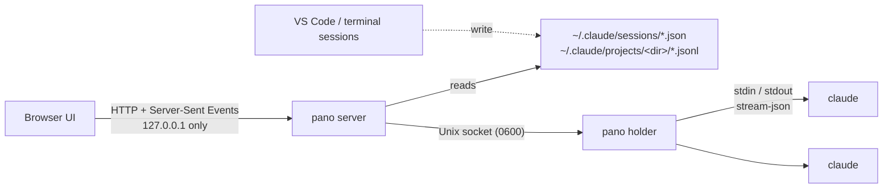

<p align="center"></p>

<h1 align="center">pano</h1>

<p align="center">
  <b>A local, zero-dependency control room for parallel Claude Code sessions.</b><br>
  See what every session is doing, what they tell each other, and drive them from one window.
</p>

<p align="center">
  <a href="https://github.com/halilibrahimd27/pano/actions/workflows/ci.yml"></a>
  
  
  
</p>



When you run several Claude Code sessions side by side — one on the API, one on infrastructure, one doing a
security review — they end up in a row of editor tabs. You can only look at one at a time, you can't see what
the others are doing, and when they message each other you never see it.

**pano** puts them on one page. It watches every session in your project directories live (including the ones
open in VS Code), shows the conversation between sessions, and lets you take a session over and keep working
with it right in the browser — with streaming replies, tool-call details and diffs, question cards, and the
controls you would expect. It is a single Python package with no dependencies, it binds to `127.0.0.1`, and
your sessions survive restarting it.

> **Try it without touching anything:** `pano --demo` starts it with a synthetic team of sessions (the data
> in all screenshots here).

## Features

**Watch everything**
- Every session of the directories you choose, grouped by where it runs: driven by pano, open in VS Code,
  open elsewhere, closed, archived.
- Live status with pulsing rings: working, waiting for your answer, your turn, idle — plus what it is doing
  right now, unread markers, and desktop notifications when a session finishes or asks you something.
- **Messages between sessions** as a graph and a list ("Security review → API refactor: SQL injection in
  `/orders/search`"), with delivery confirmed from the receiving transcript.
- An activity feed across all sessions, an overview of cards, and a Notes tab for your own markdown files
  (a journal, a TODO list).

**Drive sessions from the browser**
- Start new sessions or **continue a session you closed in VS Code**, with its full history and memory.
- Replies stream in as they are written; send while it is working and the prompt is queued; `Esc` stops it.
- Paste or drop images, use slash commands with autocomplete, insert quick prompts with one click.
- Answer **question cards** (single/multi choice, "other"), **approve plans**, and allow or deny **tool
  permissions** inline.

**See exactly what happened**
- Click any tool call to see the command and its output, or the file change as a **colored diff with line
  numbers**. Likely secrets are masked before they reach the screen.
- Background tasks with live output and a stop button; subagents; files edited.

**Control each session**
- Switch model, effort and permission mode (ask / auto-accept edits / plan / never ask).
- Context meter with one-click compact, usage limits (5-hour and 7-day), rename.
- **Rewind files** to any of your prompts, with a preview of the files and lines that will change.

**Find anything**
- `⌘K` to jump to any session or search every message, tool call and note.

**Stay out of the way**
- Python 3.9+ standard library only. One process for the web server and one tiny "holder" process that owns
  the Claude Code processes, so **upgrading or restarting pano never interrupts a session**.

## Screenshots

| | |
|---|---|
|  |  |
| **Tool call details** — commands, output with secrets masked, diffs | **Question cards** — answer without leaving the page |
|  |  |
| **Who talks to whom** — messages between sessions | **⌘K** — jump anywhere, search everything |
|  |  |
| **Overview** — every session at a glance | **Light theme**, background tasks and session details |

## Quick start

You need **Python 3.9+**, **Claude Code** installed and logged in, and **macOS or Linux**.

```bash
pipx install git+https://github.com/halilibrahimd27/pano     # or: pip install git+https://…

cd ~/code/my-project
pano                      # opens http://127.0.0.1:8787 and watches this directory
```

Or straight from a clone, without installing anything:

```bash
git clone https://github.com/halilibrahimd27/pano && cd pano
python3 -m pano --dir ~/code/my-project
python3 -m pano --demo     # synthetic data on port 8789
```

### Moving a session from VS Code to pano

pano never takes over a session that is still open somewhere else — two writers would tangle its history.
Close the session's tab in VS Code; the moment it closes, **Continue in pano** appears. To go back, press
**Release** in pano and reopen it in VS Code.

## Usage

```
pano [--dir PATH]... [--note FILE]... [--port 8787] [--permission-mode MODE] [--window]
pano --stop        # stop the web server; sessions keep running in the holder
pano --stop-all    # release pano's sessions, stop the holder and the web server
pano --demo        # synthetic, read-only data
```

| Option | |
|---|---|
| `--dir PATH` | Project directory whose sessions to show. Repeat for several projects. Default: the current directory. |
| `--note FILE` | Markdown file for the Notes tab (repeatable). Files with `## ` sections are shown as a journal, newest first. |
| `--permission-mode` | Mode for sessions pano starts: `default` (ask before acting, the default), `acceptEdits`, `plan`, `bypassPermissions`. Changeable per session in the UI. |
| `--window` | Open in a chromeless browser window instead of a tab. |
| `--no-browser` | Just print the URL. |
| `--claude-bin PATH` | The `claude` executable (default: `claude` on `PATH`). |
| `--foreground` | Run in the terminal instead of in the background (useful for debugging). |

Defaults can live in `~/.config/pano/config.json`:

```json
{
  "dirs": ["~/code/shop-api", "~/code/infra"],
  "notes": ["~/code/shop-api/JOURNAL.md"],
  "permission_mode": "default"
}
```

On macOS, `scripts/make-macos-app.sh --dir ~/code/shop-api` builds `~/Applications/pano.app`, a Dock icon
that opens pano in its own window.

**Keyboard:** `Enter` send · `Shift+Enter` new line · `/` slash commands · `Esc` stop · `⌘K` / `Ctrl+K`
palette · `Ctrl+1…9` jump to a session.

## How it works



- **Watching.** Claude Code records live sessions in `~/.claude/sessions/<pid>.json` and every conversation as
  a JSONL transcript. pano reads only the bytes appended since its last look, turns them into a timeline, and
  pushes changes to the browser within about a second. Tool results are never loaded into memory; pano only
  remembers where they are in the file and reads one when you expand it.
- **Driving.** Sessions you start or continue in pano run `claude` in **stream-json mode** — the same mode the
  official IDE integrations and the Agent SDK use — with `--resume` for existing sessions. Prompts go in on
  stdin, streamed events come out on stdout, and questions and permission prompts arrive as control requests
  that pano turns into cards.
- **Holder.** Those `claude` processes belong to a tiny separate process (`pano.holder`) rather than the web
  server. When the server restarts, it reconnects and the holder replays the current turn — including any
  question that is still waiting for you — so nothing is lost.

## Security

pano drives an agent that can run commands, so it treats your browser as hostile and your machine as private.
In short: it listens on `127.0.0.1` only, rejects foreign `Host` headers (DNS rebinding) and cross-site reads,
requires an `Origin` check plus a per-start secret token for every state-changing request, renders everything
escaped under a strict Content-Security-Policy, masks likely secrets in tool output, keeps message content out
of its log, and starts sessions in "ask before acting" mode. See [SECURITY.md](SECURITY.md) for the full threat
model and how to report a vulnerability.

## Compatibility and caveats

- **Unofficial.** pano is not made by or affiliated with Anthropic. It relies on Claude Code's stream-json
  interface and also reads local files whose format is not documented (`~/.claude/sessions`, transcripts,
  messages between sessions). A Claude Code update can change those; pano was developed against Claude Code
  2.1.3xx.
- **Platforms.** macOS and Linux. Windows is not supported (Unix sockets, paths).
- **One writer per session.** pano refuses to continue a session that is open elsewhere and warns if it gets
  opened elsewhere while pano drives it.
- **Rewind** restores local files only; it cannot undo changes a session made on other machines.
- Sessions pano drives use your normal Claude Code settings, hooks, MCP servers and account.

## Development

```bash
python -m unittest discover -s tests -v           # tests run on synthetic data, no Claude Code needed
python3 -m pano --demo --no-browser                 # then:
node scripts/take-screenshots.mjs                   # regenerates docs/screenshots (Node 22+, Chrome)
```

```
pano/server.py         transcript reader, store, session driver, HTTP API, CLI
pano/holder.py         the process that owns claude subprocesses
pano/demo.py           synthetic sessions for --demo and the tests
pano/static/index.html the whole UI (no build step, no external assets)
```

The UI is served from disk on every request, so you can edit `index.html` and reload. Issues and pull
requests are welcome — please keep the zero-dependency rule.

## License

[MIT](LICENSE). Claude and Claude Code are trademarks of Anthropic, PBC; pano is an independent project.
