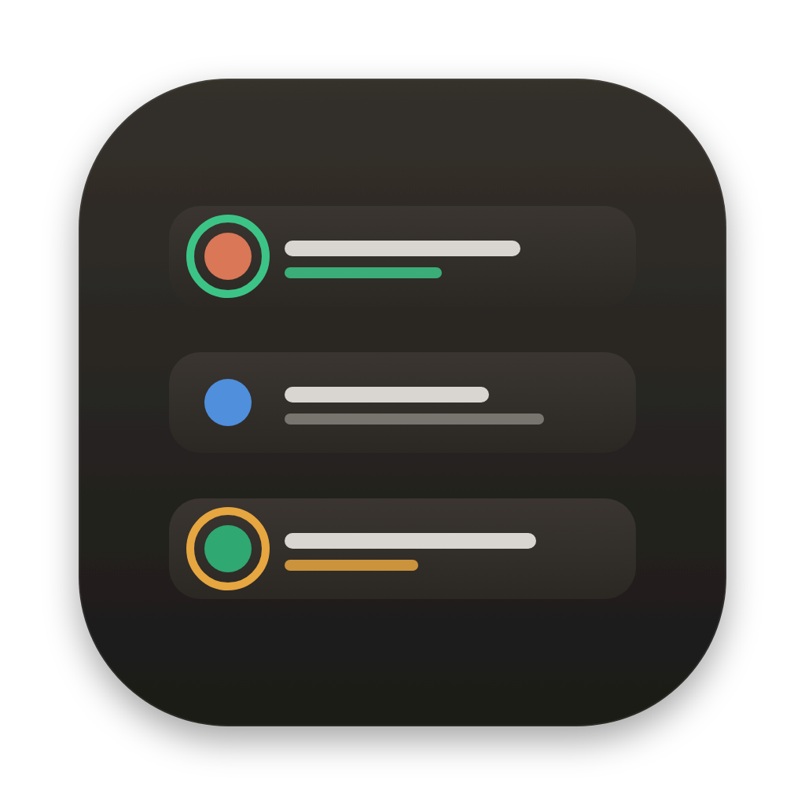
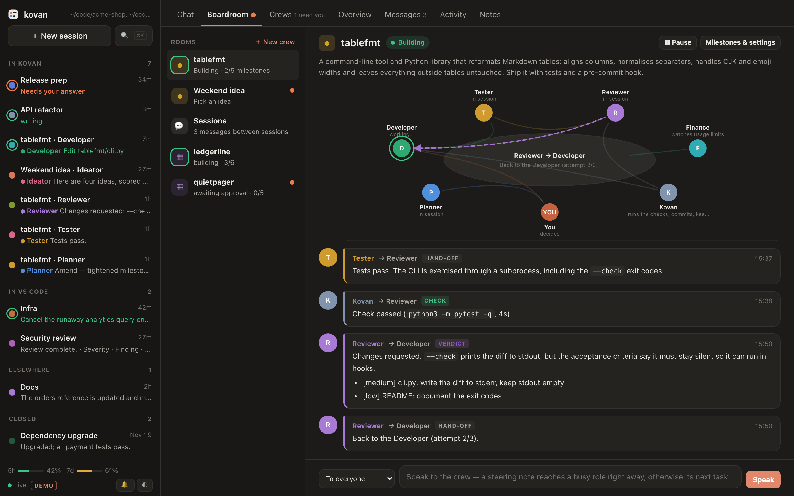
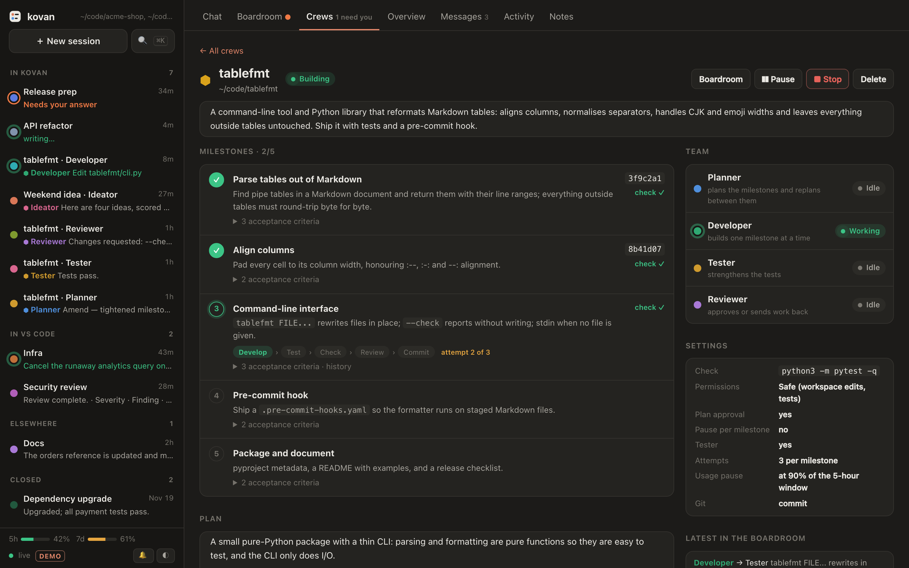
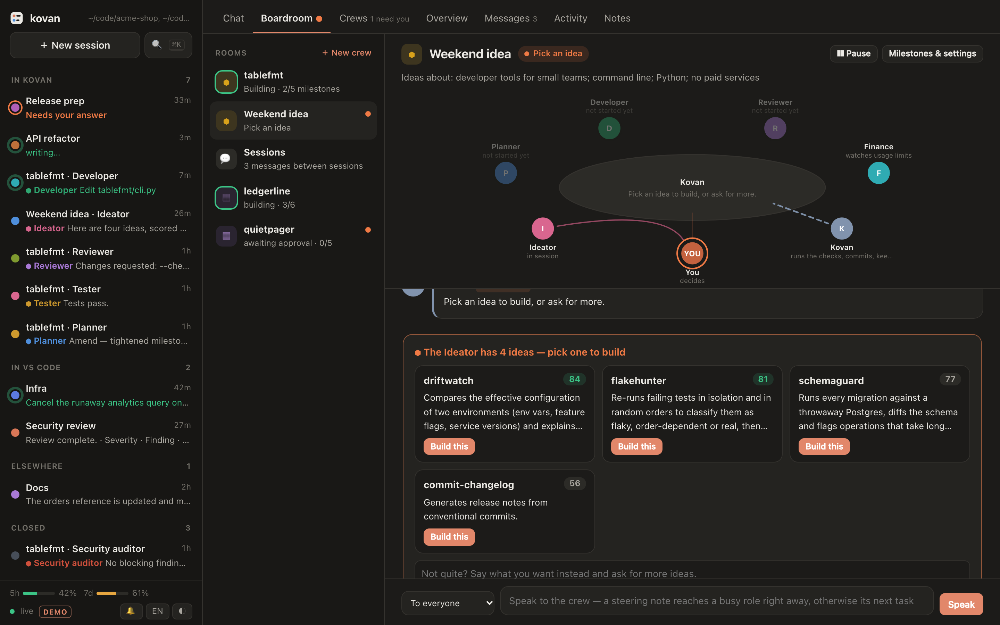
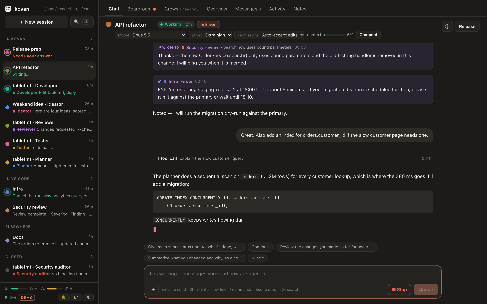
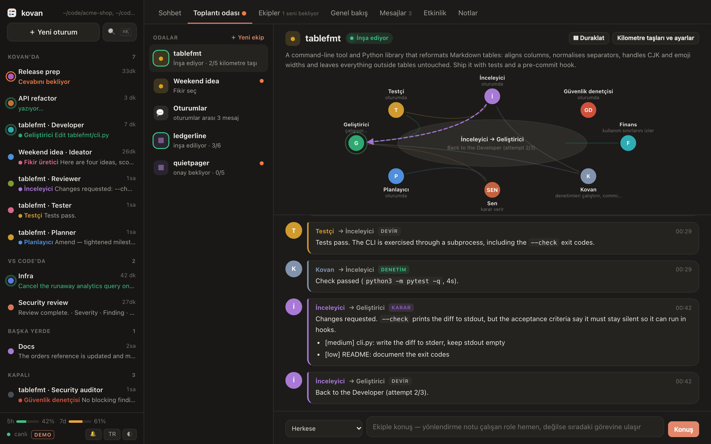
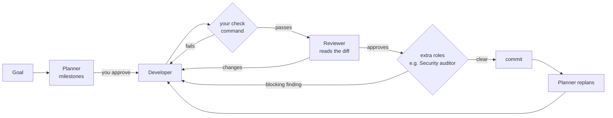

<p align="center"></p>

<h1 align="center">kovan</h1>

<p align="center">
  <b>See your Claude Code agents work together — and put a crew of them on a goal.</b>
</p>

<p align="center">
  <a href="https://github.com/halilibrahimd27/kovan/actions/workflows/cockpit.yml"></a>
  <a href="https://github.com/halilibrahimd27/kovan/actions/workflows/verify.yml"></a>
  
  
</p>



*Kovan* is Turkish for beehive. It is a local control room for [Claude Code](https://claude.com/claude-code):
all your sessions on one page, the messages they send each other, and **crews** — a Planner, a Developer and
a Reviewer that build a goal milestone by milestone while you watch them meet in the **boardroom**.
One Python package, no dependencies, nothing leaves `127.0.0.1`.

## What it does

- **Shows every session.** Live status, what each session is doing right now, and what they tell each other.
  Continue any session in the browser — even one you closed in VS Code — with streaming replies, question
  cards, tool calls and diffs.
- **Puts a crew on a goal.** You describe it (or let an Ideator propose ideas); the Planner splits it into
  milestones; the Developer builds them one by one. After each milestone kovan runs your tests, the Reviewer
  reads the real diff, and what passes becomes a commit. You approve the plan and get asked whenever a human
  should decide. Add a **Security auditor** that can block any commit, a Documenter, or roles you define
  yourself — or start from a template (feature, secure feature, bug fix, security audit). A crew can also work on
  its own branch, wait for your project's real CI after every commit and open a pull or merge request at the end.
- **Lets you sit in on the meeting.** The boardroom seats everyone at a table, shows who is working and who
  just spoke to whom, and lets you speak up.
- **Runs for days, if you want it to.** This repository also holds the **swarm engine** (formerly
  ai-dev-swarm): a 24/7 autonomous swarm on CrewAI, Postgres and Docker that ideates, builds and ships
  projects on its own. The cockpit can sit in on its boardroom too. → [Swarm engine guide](docs/swarm.md)

| | |
|---|---|
|  |  |
| **A crew** — milestones, team, settings | **Ideas mode** — scored ideas, pick one |
|  |  |
| **Driving a session** from the browser | **English or Turkish** |

## Quickstart

```bash
pipx install "git+https://github.com/halilibrahimd27/kovan#subdirectory=cockpit"

kovan --demo                      # try it on made-up data first; nothing real is touched
cd ~/code/my-project && kovan     # opens http://127.0.0.1:8787
```

No pipx? `git clone https://github.com/halilibrahimd27/kovan && cd kovan/cockpit && python3 -m kovan` works too.

## Prerequisites

| | Cockpit | Swarm engine (optional) |
|---|---|---|
| Runs on | macOS or Linux with Python 3.9+ | Docker 24+ with Compose v2.20+, 4 GB of free RAM |
| Needs | Claude Code, installed and logged in | An Anthropic API key (a GitHub token and a Telegram bot are optional) |

## First run

1. Start `kovan` in a project folder. Its Claude Code sessions appear on the left, grouped by where they run.
   Click one to read it. To drive it from kovan, close its tab in VS Code and press **Continue in kovan**.
2. Open **Crews → New crew**. Describe the goal (or choose *Suggest ideas*), pick an empty folder or a clean
   git repository, and give a check command such as `python3 -m pytest -q`.
3. The Planner goes first. Approve its plan in the **Boardroom** and watch the crew work. Every accepted
   milestone is a commit in that folder.

## How a crew works



Every role is a real Claude Code session you can open and talk to. Routine permission prompts — editing files
in the workspace, running tests, read-only git — are answered by a narrow policy; anything else (deleting
files, network access, installing packages, paths outside the folder) waits for you. Secret-looking files
are never committed, and the crew pauses before your 5-hour usage limit runs out.
Details: [cockpit/README.md](cockpit/README.md) · [cockpit/SECURITY.md](cockpit/SECURITY.md#crews).

## Configuration

Defaults live in `~/.config/kovan/config.json`:

```json
{
  "dirs": ["~/code/shop-api", "~/code/infra"],
  "notes": ["~/code/shop-api/JOURNAL.md"],
  "permission_mode": "default",
  "lang": "en",
  "swarm": "http://127.0.0.1:8080"
}
```

`dirs` are the folders whose sessions you see (new folders are added when you start a session in them),
`notes` are Markdown files for the Notes tab, `lang` is `en` or `tr`, and `swarm` connects the swarm
engine's boardroom. Add `notify` to hear on your phone when a crew needs you — a Slack/Mattermost webhook or a
Telegram bot whose buttons approve plans and retry blocked work
([setup](cockpit/README.md#notifications-on-your-phone)). All options: [cockpit/README.md](cockpit/README.md#usage). The swarm engine is configured
through `.env` — see [its configuration](docs/swarm.md#configuration).

## Operating

```bash
kovan --stop        # stop the web server; sessions keep running and come back when kovan starts again
kovan --stop-all    # also release kovan's sessions
kovan --window      # open in a window of its own (scripts/make-macos-app.sh builds a Dock app)
```

In the page: `⌘K` searches every session and note, `Esc` stops the current reply, the TR/EN button switches
the language. The swarm engine starts with `docker compose up -d` and has its own web panel at
http://127.0.0.1:8080 — see [operating the swarm](docs/swarm.md#operating).

## Getting your keys

The cockpit needs no keys: it uses your Claude Code login (notifications optionally use a webhook URL or a
Telegram bot token you create). The swarm engine needs an Anthropic API key, and
optionally a GitHub token (to publish projects) and a Telegram bot (to steer it from your phone) — see
[getting your keys](docs/swarm.md#getting-your-keys).

## Troubleshooting

| Symptom | What to do |
|---|---|
| No **Continue in kovan** button | The session is still open in VS Code or a terminal. Close it there first. |
| A crew card says *needs your OK* | A role asked for something outside the policy. Open that role's session and answer, or start the crew with the *Trusted* policy. |
| A crew is *blocked* | A milestone failed too often or the Planner needs a decision. Retry with a hint, skip the milestone, or stop. |
| Port 8787 is taken | `kovan --port 8790` (or `"port"` in the config). |
| The swarm room shows an error | Check that the swarm engine is up (`docker compose ps`). If it has `AIDEVSWARM_API_TOKEN`, set the same value as `KOVAN_SWARM_TOKEN`. |

More for the swarm engine: [troubleshooting](docs/swarm.md#troubleshooting).

## Comparison

| | Runs locally | Your own Claude Code sessions | Tests gate every step | You approve the plan | Watch the agents talk |
|---|---|---|---|---|---|
| **kovan crews** | ✅ | ✅ | ✅ your check command, optional security gate and real CI | ✅ (also from Telegram) | ✅ boardroom |
| **Swarm engine** | ✅ (Docker) | — (API key) | ✅ lint, types, tests | ✅ optional | ✅ web panel + boardroom |
| Plain Claude Code | ✅ | ✅ | manual | — | — |
| Hosted coding agents | — | — | varies | varies | partly |

## Repository

```
cockpit/          kovan: the control room, crews and the boardroom (Python standard library, no build step)
src/aidevswarm/   the swarm engine (CrewAI, Claude Agent SDK, FastAPI, Postgres + pgvector, Redis)
frontend/         the swarm engine's web panel
docs/             the swarm engine guide and architecture decision records
```

Development: `cd cockpit && python -m unittest discover -s tests` for the cockpit;
`uv sync --extra dev && make verify` for the swarm engine (lint, strict types, security scans, dependency
audit, ≥ 85 % coverage, property tests, complexity and layering checks).

## Security

kovan drives agents that can run commands, so it listens on `127.0.0.1` only, requires an Origin check and a
per-start token for every change, masks likely secrets in tool output and keeps message content out of its
logs. Read [cockpit/SECURITY.md](cockpit/SECURITY.md), the swarm engine's [THREAT_MODEL.md](THREAT_MODEL.md),
and [SECURITY.md](SECURITY.md) to report a vulnerability.

## License

[MIT](LICENSE). Claude and Claude Code are trademarks of Anthropic, PBC; kovan is an independent project.
