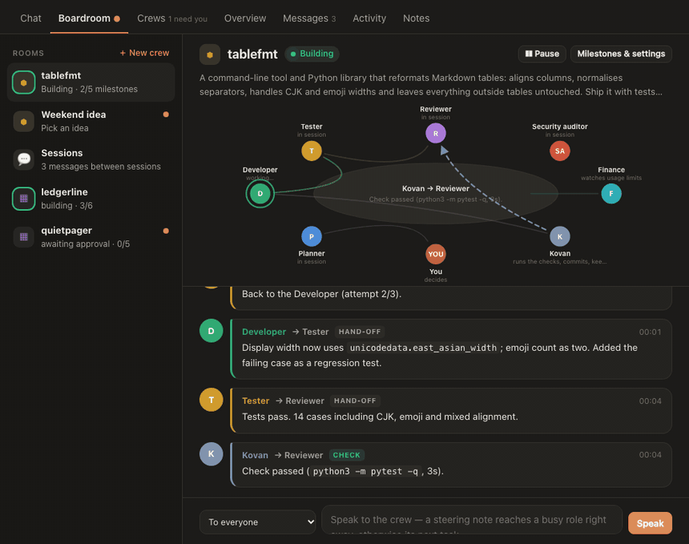
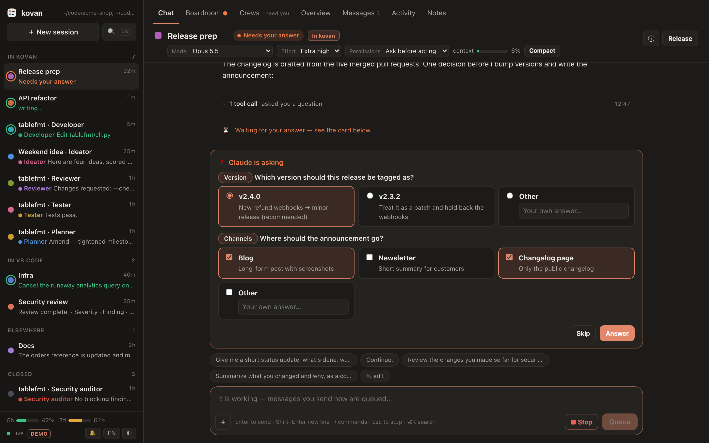
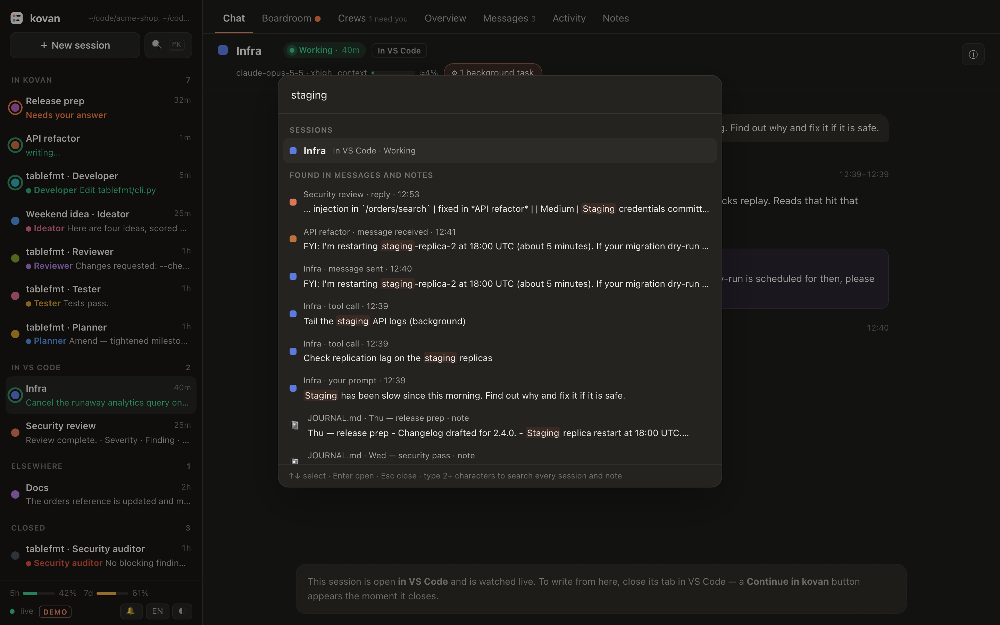
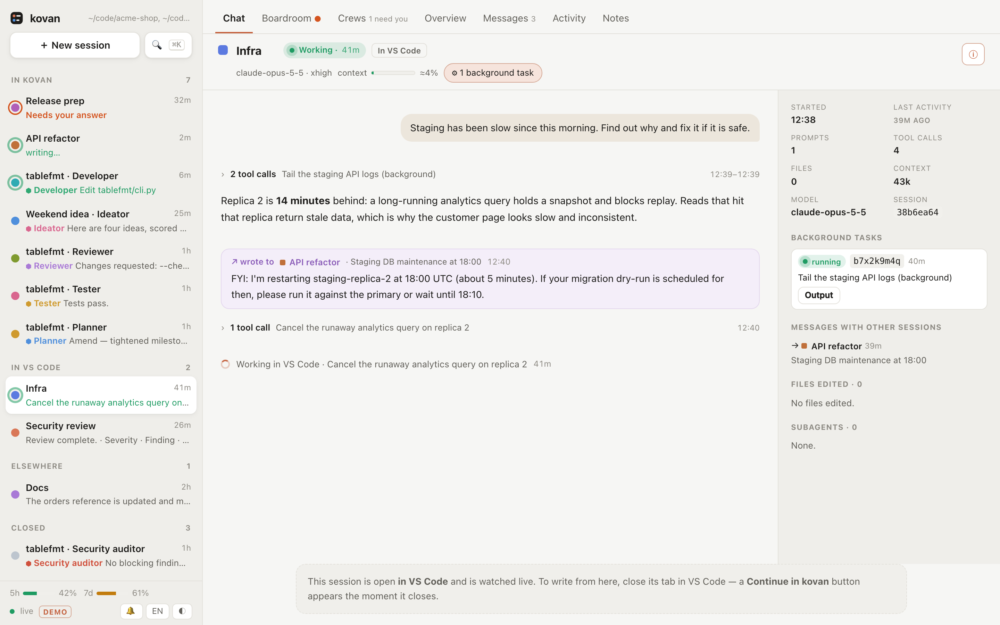
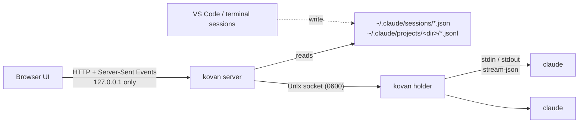

<p align="center"></p>

<h1 align="center">kovan</h1>

<p align="center">
  <b>A local, zero-dependency control room for parallel Claude Code sessions — and crews of them.</b><br>
  See what every session is doing, what they tell each other, hand a goal to a crew, and sit in on the meeting.
</p>

<p align="center">
  <a href="https://github.com/halilibrahimd27/kovan/actions/workflows/cockpit.yml"></a>
  
  
  
</p>



When you run several Claude Code sessions side by side — one on the API, one on infrastructure, one doing a
security review — they end up in a row of editor tabs. You can only look at one at a time, you can't see what
the others are doing, and when they message each other you never see it.

**kovan** puts them on one page. It watches every session in your project directories live (including the ones
open in VS Code), shows the conversation between sessions, and lets you take a session over and keep working
with it right in the browser — with streaming replies, tool-call details and diffs, question cards, and the
controls you would expect. And when you would rather delegate than drive, a **crew** — a Planner, a Developer,
an optional Tester and a Reviewer, each a real Claude Code session — builds a goal milestone by milestone while
you watch them talk in the **boardroom**. It is a single Python package with no dependencies, it binds to
`127.0.0.1`, and your sessions survive restarting it.

> **Try it without touching anything:** `kovan --demo` starts it with a synthetic team of sessions, two crews
> and a swarm project (the data in all screenshots here).

## Features

**Crews**
- Give a goal — or ask the **Ideator** for scored, self-critiqued ideas and pick one — plus a folder. The
  **Planner** writes milestones with acceptance criteria for you to approve or revise; the **Developer** builds
  one at a time; an optional **Tester** strengthens the tests; kovan runs **your check command**; the
  **Reviewer** reads the real staged diff; kovan **commits** what passes; the Planner **replans** (continue,
  amend, split or escalate) between milestones. Failed work goes back with the reasons, up to a retry budget.
- Every role is an ordinary Claude Code session — open it, read it, talk to it.
- **Extra roles**: seat up to four more — a ready-made **Security auditor** (reads every diff before the commit
  and blocks it on critical or high findings), a **Documenter** or a **Performance reviewer** — or define your
  own in a sentence or two: what it does, whether it works *after the Developer* (and may edit files) or reads
  the diff *before the commit* (and which severities block it). kovan can remember your roles for later crews.
- **Templates**: *Feature crew*, *Secure feature crew* (with the Security auditor), *Bug-fix crew* (root cause
  plus a regression test, nothing more) and *Security audit crew* (a `SECURITY_AUDIT.md` report first, then one
  fix per critical or high finding).
- Only the tree the Reviewer read can be committed: if files change after the review, kovan runs the check and
  the review again.
- **Pull requests and real CI**: a crew can work on its own branch and open a pull request (GitHub, via `gh`) or
  a merge request (GitLab, via push options) at the end, and wait for the project's **real CI** after every
  commit — GitHub Actions, commit statuses from Jenkins and others, GitLab pipelines (via `glab`), or a status
  command of your own. A red CI sends the milestone back to the Developer with the failing jobs and their logs.
- Steering notes reach a working role immediately, otherwise its next task. Pause, resume, stop, retry, skip.
- A narrow permission policy answers routine prompts; everything else waits for you (see [SECURITY.md](SECURITY.md#crews)).
- The finance officer pauses a crew before the 5-hour usage window runs out and resumes it afterwards.

**The boardroom**
- One room per crew, one for your sessions' messages to each other, and one per project of the
  [swarm engine](../README.md#the-swarm-engine-ai-dev-swarm) (`--swarm`).
- A round table with everyone's seat: who is working right now, who needs you, and animated arcs for who just
  spoke to whom. Below it, the meeting as a chat — hand-offs, check results, verdicts, replans, your decisions.
- Plan approval, idea picking and "blocked" cards right in the meeting; a **Speak** box in every room.

**Watch everything**
- Every session of the directories you choose, grouped by where it runs: driven by kovan, open in VS Code,
  open elsewhere, closed, archived.
- Live status with pulsing rings: working, waiting for your answer, your turn, idle — plus what it is doing
  right now, unread markers, and desktop notifications when a session finishes or asks you something.
- **Messages between sessions** as a graph and a list ("Security review → API refactor: SQL injection in
  `/orders/search`"), with delivery confirmed from the receiving transcript.
- An activity feed across all sessions, an overview of cards, and a Notes tab for your own markdown files
  (a journal, a TODO list).

**Drive sessions from the browser**
- Start new sessions in **any folder** (it joins the watched list) or **continue a session you closed in VS Code**,
  with its full history and memory.
- Replies stream in as they are written; send while it is working and the prompt is queued; `Esc` stops it.
- Paste or drop images, use slash commands with autocomplete, insert quick prompts with one click.
- Answer **question cards** (single/multi choice, "other"), **approve plans**, and allow or deny **tool
  permissions** inline.

**See exactly what happened**
- Click any tool call to see the command and its output, or the file change as a **colored diff with line
  numbers**. Likely secrets are masked before they reach the screen.
- Background tasks with live output and a stop button; subagents; files edited.

**Control each session**
- Switch model, effort and permission mode (ask / auto-accept edits / plan / never ask).
- Context meter with one-click compact, usage limits (5-hour and 7-day), rename.
- **Rewind files** to any of your prompts, with a preview of the files and lines that will change.

**Find anything**
- `⌘K` to jump to any session or search every message, tool call and note.

**Your language**
- English and Turkish. kovan follows the browser, `--lang tr` (or `"lang"` in the config) sets a default, and
  the TR/EN button in the corner switches. Crews started from a Turkish page speak Turkish in the boardroom.
- Your own content — messages, code, session names — is never translated.

**Stay out of the way**
- Python 3.9+ standard library only. One process for the web server and one tiny "holder" process that owns
  the Claude Code processes, so **upgrading or restarting kovan never interrupts a session**.

## Screenshots

| | |
|---|---|
|  |  |
| **Tool call details** — commands, output with secrets masked, diffs | **Question cards** — answer without leaving the page |
|  |  |
| **Who talks to whom** — messages between sessions | **⌘K** — jump anywhere, search everything |
|  |  |
| **Overview** — every session at a glance | **Light theme**, background tasks and session details |
|  |  |
| **A crew** — milestones with their pipeline, the team, settings | **Ideas mode** — scored ideas, pick one or ask for more |
|  |  |
| **Driving a session** — replies stream in as they are written | **The swarm's boardroom**, with `--swarm` |
|  | |
| **Türkçe** — the whole interface, and crews that speak it | |

## Quick start

You need **Python 3.9+**, **Claude Code** installed and logged in, and **macOS or Linux**.

```bash
pipx install "git+https://github.com/halilibrahimd27/kovan#subdirectory=cockpit"     # or pip install …

cd ~/code/my-project
kovan                      # opens http://127.0.0.1:8787 and watches this directory
```

Or straight from a clone, without installing anything:

```bash
git clone https://github.com/halilibrahimd27/kovan && cd kovan/cockpit
python3 -m kovan --dir ~/code/my-project
python3 -m kovan --demo     # synthetic data on port 8789
```

### Your first crew

Open **Crews → New crew**, pick a template, describe the goal (or choose *Suggest ideas*), pick a folder — an
empty one or a clean git repository — and a check command such as `python3 -m pytest -q`. Tick extra roles if
you want them (or **＋ Define a role**). The Planner goes first; approve its plan in the boardroom and watch.
Every accepted milestone is a commit in that folder.

Each milestone goes through the same steps: Developer → Tester (optional) → extra roles that work *after the
Developer* → your check command → Reviewer → extra roles that read the diff *before the commit* → commit →
the project's CI (optional). A blocking finding or a failed step sends the work back to the Developer with the
reasons.

**Pull requests and the CI gate.** Tick *Open a pull / merge request at the end* and the crew creates a branch
(`kovan/<name>`) from the current one, pushes every milestone to it and opens the request when it finishes — on
GitHub with the `gh` CLI (a draft right after the first push when the CI gate is on, so `pull_request` workflows
run, marked ready at the end), on GitLab with `git push -o merge_request.create` on the first push. Tick *Wait
for the project's CI* and a milestone only counts as done when the CI on its commit is green: kovan reads GitHub
check runs and commit statuses with `gh`, GitLab pipelines and statuses with `glab`, or runs your **status
command** (`{sha}` and `{branch}` are filled in; exit 0 = green, 75 = still running, anything else = red). Both
need a git repository with an `origin` remote; if no CI result appears for a commit within five minutes, the
crew stops and asks you.

### Crews on a real project

A crew can work on an existing project for days. These settings are under **Advanced** in the New crew dialog,
and most can be changed later under **Settings → Edit** on the crew page:

- **Models and effort per role.** For example a large model with high effort for the Planner and the Security
  auditor, and a faster one for the Tester. A change applies to the next session the role starts.
- **Fresh sessions** (on by default). The Developer, Tester, Reviewer and extra roles start every milestone in a
  new session, so the context stays small instead of growing with every milestone. The task carries what is
  already done (titles, commits, summaries), and the code and git history carry the rest. The Planner keeps its
  session.
- **Working hours.** Choose days and a start and end time. After the end no new turn starts (a running one
  finishes) and the crew goes on at the next start. A **start time** makes a crew wait until then; its branch is
  made when it starts, from what the base branch is at that moment.
- **Usage pauses.** A crew pauses when the 5-hour window reaches 90% or the weekly window reaches 95% (both can
  be changed), and goes on when the window resets.
- **Allowed and denied commands.** Patterns that roles may run without asking you, one per line. `*` is a glob
  within a word, `**` stands for any arguments, and a URL must be written in the pattern itself:
  `curl ** http://127.0.0.1:18080* **` reaches that port and nothing else. Denied patterns always ask you.
- **Branch, push command and commit trailer**, e.g. `feature/m1-sso`, your own push script with `{branch}`, and a
  `Co-Authored-By:` line. With a push command the crew pushes after every milestone. At the end it gives you a
  link that opens the merge or pull request with the branches filled in; opening it is up to you.
- **Idle command.** Runs when the crew rests for the day or finishes, e.g. `make down`.
- **Advisor.** One of your existing sessions, for example the one where you designed the project, reviews the
  plan once before you approve it. kovan asks it in a fork (`--fork-session`, read-only tools), so its own
  conversation is left untouched. Its answer appears in the boardroom before the approval.
- **Usage.** The crew page shows each role's turns, output tokens, cache reads, context size and time, plus how
  the weekly window moved. Each milestone shows its own share.

### Moving a session from VS Code to kovan

kovan never takes over a session that is still open somewhere else — two writers would tangle its history.
Close the session's tab in VS Code; the moment it closes, **Continue in kovan** appears. To go back, press
**Release** in kovan and reopen it in VS Code.

## Usage

```
kovan [--dir PATH]... [--note FILE]... [--port 8787] [--permission-mode MODE] [--window]
kovan --stop        # stop the web server; sessions keep running in the holder
kovan --stop-all    # release kovan's sessions, stop the holder and the web server
kovan --demo        # synthetic, read-only data
```

| Option | |
|---|---|
| `--dir PATH` | Project directory whose sessions to show. Repeat for several projects. Default: the current directory. |
| `--note FILE` | Markdown file for the Notes tab (repeatable). Files with dated `##`/`###` headings are shown as a journal, newest first (`###` entries grouped under a bare `## <day>`); others as a document. |
| `--permission-mode` | Mode for sessions kovan starts: `default` (ask before acting, the default), `acceptEdits`, `plan`, `bypassPermissions`. Changeable per session in the UI. |
| `--window` | Open in a chromeless browser window instead of a tab. |
| `--no-browser` | Just print the URL. |
| `--claude-bin PATH` | The `claude` executable (default: `claude` on `PATH`). |
| `--lang en\|tr` | UI language until you choose one in the page (default: follow the browser). |
| `--notify-test` | Send a test message to every configured channel (Claude, webhook, Telegram) and exit. |
| `--swarm URL` | Show the boardroom of a running [swarm engine](../README.md#the-swarm-engine-ai-dev-swarm), e.g. `http://127.0.0.1:8080` (loopback only). If the swarm has an API token, put it in `KOVAN_SWARM_TOKEN`. |
| `--foreground` | Run in the terminal instead of in the background (useful for debugging). |

Defaults can live in `~/.config/kovan/config.json`:

```json
{
  "dirs": ["~/code/shop-api", "~/code/infra"],
  "notes": ["~/code/shop-api/JOURNAL.md"],
  "permission_mode": "default",
  "lang": "en",
  "swarm": "http://127.0.0.1:8080"
}
```

On macOS, `scripts/make-macos-app.sh --dir ~/code/shop-api` builds `~/Applications/kovan.app`, a Dock icon
that opens kovan in its own window.

### Notifications on your phone

When a crew needs you — a plan to approve, an idea to pick, a blocked milestone, a command outside its policy —
or finishes, kovan can tell you three ways:

- **Through Claude** — a push from the Claude app on your phone, the same kind Claude Code sends itself. Nothing
  to create: kovan keeps one small Claude Code session connected with Remote Control. It shows up as **kovan** in
  the Claude app with every message and its details, and its only tool is PushNotification.
- A **Slack- or Mattermost-compatible incoming webhook**.
- A **Telegram bot** with buttons: **Approve / Revise / Stop** a plan, pick an idea, **Retry / Skip / Stop** a
  blocked crew, **Continue / Pause** after a milestone. *Revise* and *Retry* ask you to reply with the change or a
  hint. `/status` lists your crews.

```json
"notify": {
  "claude": true,
  "webhook": "https://chat.example.com/hooks/…",
  "telegram": {"token": "123456:ABC…", "allow": [123456789]},
  "permissions": false,
  "sessions": false
}
```

Use any of them, or all of them. `kovan --notify-test` sends a test message to every channel you set up.

**Claude** needs three things:
- Claude Code logged in with your claude.ai account, the account Remote Control works with.
- The Claude app on your phone.
- "Push when Claude decides" turned on in Claude Code's `/config`.

Each notification is one short turn on a small model. That is about 2,000 tokens, mostly cached, and it counts
toward your usage like any Claude Code turn. `{"model": "sonnet", "name": "kovan"}` picks another model or
conversation name. The session starts with the first notification, rests after 20 quiet minutes and comes back to
the same conversation. It is one way: you answer in kovan.

**Telegram** setup:
1. Create a bot with [@BotFather](https://t.me/BotFather) and put its token in `telegram.token`. It can also go
   in the `KOVAN_TELEGRAM_TOKEN` environment variable, and the webhook URL in `KOVAN_WEBHOOK_URL`.
2. Start kovan and send `/start` to your bot. While nobody is allowed yet, it answers with your user id.
3. Put that id in `allow` and restart kovan.

Buttons work only for the user ids in `allow`; anyone else is ignored. `"permissions": true` adds **Allow /
Deny** buttons for a crew's permission prompts — off by default, because it approves commands from your phone.
`"sessions": true` also tells you when any watched session waits for your answer. Messages include crew names,
plan and idea titles, reasons and the command a role wants to run, with likely secrets masked; the token and
the webhook URL never appear in kovan's log.

**Keyboard:** `Enter` send · `Shift+Enter` new line · `/` slash commands · `Esc` stop · `⌘K` / `Ctrl+K`
palette · `Ctrl+1…9` jump to a session.

## How it works



- **Watching.** Claude Code records live sessions in `~/.claude/sessions/<pid>.json` and every conversation as
  a JSONL transcript. kovan reads only the bytes appended since its last look, turns them into a timeline, and
  pushes changes to the browser within about a second. Tool results are never loaded into memory; kovan only
  remembers where they are in the file and reads one when you expand it.
- **Driving.** Sessions you start or continue in kovan run `claude` in **stream-json mode** — the same mode the
  official IDE integrations and the Agent SDK use — with `--resume` for existing sessions. Prompts go in on
  stdin, streamed events come out on stdout, and questions and permission prompts arrive as control requests
  that kovan turns into cards.
- **Crews.** A small orchestrator loop inside the server drives each crew's role sessions through the same
  stream-json channel: it sends a role its task (with the role's charter on the first turn), waits for the
  turn's result, reads the JSON object the role ends its reply with, and decides the next step. Crews are
  plain JSON files in `~/.local/state/kovan/crews/`, so they survive restarts like the sessions do.
- **Holder.** Those `claude` processes belong to a tiny separate process (`kovan.holder`) rather than the web
  server. When the server restarts, it reconnects and the holder replays the current turn — including any
  question that is still waiting for you — so nothing is lost.

## Security

kovan drives an agent that can run commands, so it treats your browser as hostile and your machine as private.
In short: it listens on `127.0.0.1` only, rejects foreign `Host` headers (DNS rebinding) and cross-site reads,
requires an `Origin` check plus a per-start secret token for every state-changing request, renders everything
escaped under a strict Content-Security-Policy, masks likely secrets in tool output, keeps message content out
of its log, and starts sessions in "ask before acting" mode. See [SECURITY.md](SECURITY.md) for the full threat
model and how to report a vulnerability.

## Compatibility and caveats

- **Unofficial.** kovan is not made by or affiliated with Anthropic. It relies on Claude Code's stream-json
  interface and also reads local files whose format is not documented (`~/.claude/sessions`, transcripts,
  messages between sessions). A Claude Code update can change those; kovan was developed against Claude Code
  2.1.3xx.
- **Platforms.** macOS and Linux. Windows is not supported (Unix sockets, paths).
- **One writer per session.** kovan refuses to continue a session that is open elsewhere and warns if it gets
  opened elsewhere while kovan drives it.
- **Rewind** restores local files only; it cannot undo changes a session made on other machines.
- Sessions kovan drives use your normal Claude Code settings, hooks, MCP servers and account.

## Development

```bash
python -m unittest discover -s tests -v           # synthetic data and fake role sessions; no Claude Code needed
python3 -m kovan --demo --no-browser                 # then:
node scripts/take-screenshots.mjs                   # regenerates docs/screenshots (Node 22+, Chrome)
node scripts/make-gif.mjs                           # regenerates docs/boardroom.gif (also needs ffmpeg)
```

```
kovan/server.py         transcript reader, store, session driver, HTTP API, CLI
kovan/crew.py           crews: role charters, extra roles and templates, the plan → build → check → review loop
kovan/ci.py             pull / merge requests and the CI gate (gh, glab, git push options, a status command)
kovan/notify.py         notifications: Claude push (Remote Control), webhook, Telegram buttons
kovan/swarm.py          client for the swarm engine's API (the boardroom's swarm rooms)
kovan/holder.py         the process that owns claude subprocesses
kovan/demo.py           synthetic sessions for --demo and the tests
kovan/static/index.html the whole UI (no build step, no external assets)
```

The UI is served from disk on every request, so you can edit `index.html` and reload. Issues and pull
requests are welcome — please keep the zero-dependency rule.

**Releasing.** Bump `kovan/__init__.py` and the changelog, tag `vX.Y.Z`, and publish a GitHub release. The
*Publish to PyPI* workflow (`.github/workflows/publish.yml`, run by hand) builds the sdist and wheel, checks them
and uploads them with PyPI trusted publishing — no token in the repository. It needs a one-time setup on PyPI: a
trusted publisher for the project `kovan`, repository `halilibrahimd27/kovan`, workflow `publish.yml`,
environment `pypi`.

## License

[MIT](LICENSE). Claude and Claude Code are trademarks of Anthropic, PBC; kovan is an independent project.
